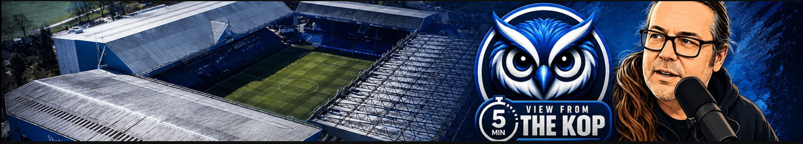

## Introduction

Sheffield Wednesday lost 1-0 to Middlesbrough, continuing their struggles this season. Manager Mark Pederson made some tactical changes, but the team's issues persist, especially in front of goal. Let’s dive into the details from the match.

  

  

    <h2 style="margin-top: 0;">22/04/26 Middlesbrough 1-0 SWFC: Owls slump again as we gift Boro the win</h2>

    
<strong>Five Minute View From The Kop</strong>

    <audio controls preload="metadata" style="width: 100%;">
      <source src="https://anchor.fm/s/f9faf04c/podcast/play/118880039/https%3A%2F%2Fd3ctxlq1ktw2nl.cloudfront.net%2Fstaging%2F2026-3-22%2F7870f49c-ece8-bdd0-63fe-61774b585072.mp3" type="audio/mpeg">
      Your browser does not support the audio player.
    </audio>

  

<blockquote>
We've been having to tweak the midfield, and marvellous Nakamba had his first start. I always thought he looked a little bit small, but apparently he's 5'10 and has a good pedigree as an international and a regular premiership player.
</blockquote>

## Episode transcript

Cheffy Wednesday, 5 minute view from The Kop

Well, we dipped again. Unfortunately, after not losing in 3 matches, we went down 1-0 to Middlesbrough. Very similar performance to how we've seen throughout the season really. Showed some spirit, but shat ourselves in the foot.

I think there's a few things about this evening's match.

## Midfield Changes and Nakamba’s Performance

## Manager’s Tactical Adjustments

Firstly, credit to Pederson for tinkering around a little bit with the starting line-up. Whether he meant to or not, we've got Cooper in the net because Pearce-Charles had an injury and wasn't ready for tonight. We've been having to tweak the midfield, and marvellous Nakamba had his first start. I always thought he looked a little bit small, but apparently he's 5'10 and has a good pedigree as an international and a regular premiership player. To be fair, I thought he looked pretty tidy today.

He was on for quite a while and I don't think he looked out of place. He didn't boss it, and we saw Chalobah come in later and he just threw himself around quite a bit more. No wonder he picked up his injuries. Chalobah seems to chuck himself around a little bit more, but I thought Nakamba was tidy. We got Eskyn there, Jovis Thornton was playing, and again, the issues that we seem to be having with the kids this season.

So he's come in and gone off injured unfortunately. But I thought, again, he played okay. It just seems like we've got a bunch. There's talk about Rio Shipton leaving, and again, you know, another decent player. You know, you've got Liam Palmer who's made a career out of being a decent player. Nothing particularly outstanding. So what keeps somebody on Wednesday and what ends up putting them in a league one team? Well, that's us next season, isn't it?

So we'll have to see who we're going to keep.

## Substitutions and Late Offensives

Some of these players could really come in handy for us.

A few little tweaks. One of the things that we've levelled at Pederson this season is his lack of bringing somebody on attacking at a decent time. Tends to be very, very late. And you know, we got Grainger coming on in the 68th minute. Charlie Brown Low came on just a bit before taking off Nakamba and Charlie McNeil. You could say that they were more attacking substitutions, but then Grainger coming on for Thornton who went off injured.

He did throw himself a bar.

## Team’s Struggles in Attack

We only had one shot on target all match, and that was a very quick reaction shot from Grainger. Shows he's a striker and he also got himself stuck in to one or two tasty challenges as well. So you know, I thought he did well when he came on. It would be nice to see a bit more of him as we go along. I know there's a panic because we just think, well, if we stick anybody in for any length of time, they're just going to get injured.

## Defensive Issues and Early Goals

But nothing to lose really this season.

Going back right to the beginning of the match, and again, we had this period where we seemed to just be conceding really early. I remember United a couple of minutes in, Bamford, but 11 minutes in, we'd been tapping the ball around at the back and looked a bit nervy. We're doing that, and we've got Cooper in the net. Cooper, I thought he did okay, but he's not Piers Charles. He's not the same confident player with the ball at his feet.

He seems okay, and if we end up with him next season, I think he'll be good. But Otik Baio ended up playing the final ball back towards him, but he'd obviously not looked to see where he was actually position-wise. He ended up some distance away, and the striker just nipped in and got the ball and scored. And I wouldn't have blamed Cooper at all really on that. I think that's Otik Baio's issue. Having said that, he played okay for the rest of the match.

Trying to really put me finger on and I had been all season really to sort of say this is exactly where we're falling short. You can generally say that we'll clear the ball and it always goes to the opposition. We seem to perhaps not put as much into the challenges. And I sort of noticed at one point, Middlesbrough seemed to be winning the challenges. Like they've got a little bit more to lose. Obviously, they had because they're up in the play-off places.

They hadn't won in quite a few games, which is a bit surprising really. They looked not a bad side really. And they pretty much bossed the game, although we gave them a few frights without really anything coming of it. As I say, we only had the one shot on target, but we had a few shots and we had a few runs forward, but quite ineffective really. Nothing to come out of it at the back. Couple of scary moments, but yeah, we I think we gave them a tough night and made them scrap.

Made them probably look a worse team than what they probably have been with some of the more free-flowing teams. But yeah, I like to see that we're getting forward a little bit. We've just not really got anybody there to finish off. There's times when we've had the ball out wide, certainly at home the other day, had the ball out wide, and people saying you don't get ball over and there's nobody in the middle. There isn't actually anybody in the middle, and sometimes the person with the ball on the wing is Yates and he's playing up for them in the middle.

So some might need sorting out really on that. But yeah, not a bad performance tonight really. Some highlights as I say, nice to see Grenier get a little bit more time. Chalobas Tenasete, Nakamba's been tied at Otigbayo, he sort of did well. Adam Haller again, he's our outlet going forward. Interestingly, on Saturday, we were playing him and Kibachi on the same side, which are we've got nothing going now the other side. I mean, Fazia has got some skill, but we just don't push on that side really.

All and Palmer doesn't want to be getting up and down, although he was on Saturday, he can't keep doing that all the time. So but Adam Haller, yeah, he's certainly and it's good to have Max Lowe at the back. Although I don't think he's quite really up to speed of a full match racing around. Because you're not going to get an easy time are you as a Schiffy wins the Defender.

OK, well, nearly the end of the season, and let's see how we go on the next match. Which is going to be away at Oxford. Before the final match at home. Are we going to get any points? Well, Oxford are currently 22nd, and West Brom have climbed up to 18 now. They've won the last couple of matches. So Oxford maybe that's the one, otherwise, yeah, I just can't see us doing it anyway. Until then, bye for now, and up the Els.

---

*Disclaimer: This is an AI-assisted transcript of an audio recording. While efforts have been made to improve readability, occasional transcription errors may remain.*

